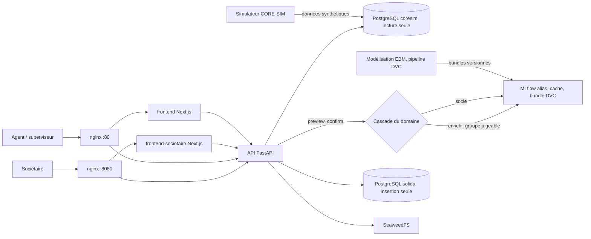

<div align="center">
  <h1>SOLIDA</h1>
  <p><b>Aide une coopérative d'épargne et de crédit à décider d'un microcrédit : probabilité de défaut à 30 jours, facteurs explicatifs, décision proposée, sous contrôle humain et dans un journal non réécrivable.</b></p>
  
  
  
  
  
  
  <br/>
  
  
  
  
  <br/>
  <p>
    <a href="#démarrer-en-cinq-minutes">Démarrer</a> ·
    <a href="#architecture">Architecture</a> ·
    <a href="#stack-technique">Stack</a> ·
    <a href="#structure-du-dépôt">Structure</a> ·
    <a href="#tests">Tests</a>
  </p>
</div>

SOLIDA aide une coopérative d'épargne et de crédit à décider d'un microcrédit : une probabilité de défaut à 30 jours, les facteurs qui l'expliquent, une décision proposée, le tout sous contrôle humain et consigné dans un journal qu'on ne peut pas réécrire.

Le difficile : noter un emprunteur qui n'a presque aucun papier, et un groupe en caution solidaire que l'on n'a pas toujours le droit de juger.

## Sommaire

- [Ce que ça apporte](#ce-que-ça-apporte)
- [Le problème](#le-problème)
- [Démarrer en cinq minutes](#démarrer-en-cinq-minutes)
- [Architecture](#architecture)
- [Stack technique](#stack-technique)
- [Structure du dépôt](#structure-du-dépôt)
- [Tests](#tests)
- [Limites et suite](#limites-et-suite)
- [Licence](#licence)
- [Contact](#contact)

## Ce que ça apporte

- **Un score qu'on peut défendre.** Deux modèles EBM (Explainable Boosting Machine), un socle individuel et un modèle enrichi pour les groupes. Chaque décision sort avec ses contributions par variable et une fiche de justification exportable en PDF.
- **Un choix de modèle qui s'explique.** Une règle de cascade du domaine décide entre socle et enrichi et enregistre le motif de bascule : sans groupe, groupe trop petit, groupe sans historique, variables périmées.
- **Un historique protégé contre la réécriture.** Les décisions et le journal d'audit sont protégés par des triggers PostgreSQL en insertion seule. Un trigger bloque la modification, y compris pour le propriétaire de la table.

## Le problème

Une agente de coopérative à Lomé reçoit une demande de crédit d'un commerçant. Il a une épargne régulière, pas de fiche de paie, parfois un groupe de caution derrière lui. Elle décide seule, avec peu d'éléments formalisés. Rien ne garantit que deux agentes jugent le même dossier de la même façon, ni qu'on retrouve plus tard pourquoi.

SOLIDA remplace cette décision isolée par une recommandation chiffrée et motivée. Elle part de la trajectoire d'épargne et du comportement de remboursement. La personne garde la main : elle prévisualise, puis confirme.

## Démarrer en cinq minutes

Prérequis : Docker, Docker Compose et un shell bash (sous Windows, `scripts/demarrer.ps1` joue le même rôle).

```bash
git clone https://github.com/Jean-Paul15/SOLIDA.git && cd SOLIDA
./scripts/demarrer.sh
curl http://localhost/api/v1/health
make back-test
```

Le script vérifie Docker, génère un `.env` local avec des secrets aléatoires s'il manque, construit les images et attend que l'API réponde. L'interface agents et superviseurs ouvre sur `http://localhost`, le portail sociétaire sur `http://localhost:8080`. Les comptes de démonstration, réservés à l'usage local, sont documentés dans `docs/backend/04-authentification.md`.

## Architecture



Trois choix portent le projet.

**Le domaine ne connaît ni la base ni le web.** Le backend suit une Clean Architecture : `domain`, `application`, `adapters`, `infrastructure`. Un contrat `import-linter` impose le sens des dépendances et interdit au domaine d'importer FastAPI, SQLAlchemy, psycopg ou toute autre bibliothèque de ce type. Les règles de crédit (cascade, grille, plafond progressif, capacité de remboursement) se testent sans base de données.

**Le modèle se charge par repli.** L'adaptateur `EBMScoringModel` essaie d'abord l'alias MLflow, puis un cache vérifié, puis le bundle versionné avec DVC. L'API démarre avec un modèle vérifié même quand MLflow est absent. L'entraînement ne pose jamais lui-même l'alias champion : une revue humaine l'active après contrôle de la calibration, de l'AUC et des écarts par zone.

**Aucune fuite du futur.** Pour chaque feature, le pipeline de modélisation ne lit que les événements antérieurs à la date de déblocage. La cible est construite à part, depuis les échéances : bon de 0 à 14 jours de retard, indéterminé de 15 à 29, défaut dès 30. Une échéance n'est évaluée qu'à 90 jours après son émission.

La cascade se joue sur quatre conditions, dans l'ordre de leur dépendance : appartenir à un groupe, compter au moins 5 membres, avoir au moins 3 crédits antérieurs soldés, disposer de variables vieilles de moins de 7 jours. Ces seuils sont des paramètres, pas des constantes.

## Stack technique

| Domaine | Technologies | Rôle dans le projet |
|---|---|---|
| Données |     | Base applicative en insertion seule, base CORE-SIM en lecture seule, stockage objet, versionnage des données et du pipeline |
| IA |    | Modèles EBM explicables, calibration, alias de modèle et artefacts |
| Backend |       | API, migrations, accès aux données, authentification (fastapi-users), fiche de justification en PDF |
| Interface |      | Interface agents et superviseurs, portail sociétaire |
| Infrastructure |   | Orchestration de la pile, reverse proxy sur les ports 80 et 8080 |
| Qualité et CI |        | Tests, lint, typage, contrat d'architecture, intégration continue des frontends, mise à jour des dépendances |

## Structure du dépôt

```
backend/              API FastAPI, migrations Alembic, tests (domain, application, adapters, integration)
frontend/             interface agents et superviseurs (Next.js)
frontend-societaire/  portail sociétaire (Next.js)
modelisation/         features, entraînement, évaluation et model cards des modèles EBM
simulateur/           générateur CORE-SIM de données synthétiques
infra/                configuration nginx et scripts d'initialisation PostgreSQL
scripts/              démarrage en une commande (bash et PowerShell)
docs/                 documentation technique : backend, frontend, infra, formules
03-MODELE/            notes de conception du modèle et de la politique de crédit
docker-compose.yml    orchestration de la pile
dvc.yaml              pipeline : génération, features, entraînement
Makefile              cibles back-* et front-* exécutées via Docker
```

## Tests

Pour la qualité, `make back-lint`, `make back-typecheck`, `make back-imports` et `make front-test` complètent `make back-test`. Hors Docker, `uv sync --locked` puis `uv run pytest tests/domain` depuis `backend/` lance les tests de domaine sans aucune base.

## Limites et suite

Le périmètre est un choix : un prototype de hackathon (Hackathon National d'Innovation CIF / DigiCoop-WA+, thématique 02, Lomé, septembre 2026), construit pour montrer la chaîne complète sur des données synthétiques.

- Les données viennent du simulateur. Aucune performance sur données réelles n'est établie, et rien ici n'en revendique.
- Le modèle recommande, l'humain décide.
- Certains seuils métier (grille, cascade) sont des valeurs de départ à valider avec la coopérative. Ils sont listés dans `docs/backend/03-decisions-provisoires-a-revoir.md`.
- L'intégration continue couvre les frontends. Le backend se vérifie avec les cibles `make`.
- Les comptes de démonstration ne se déploient pas tels quels.
- Certains documents de `docs/backend/` mentionnent encore un modèle de substitution `ModeleConstant`. Le code actuel charge les modèles EBM.

La suite naturelle : valider les seuils avec une coopérative, rejouer l'entraînement sur des données réelles anonymisées, étendre la CI au backend.

## Licence

Tous droits réservés. Le fichier `LICENSE` interdit la copie, la modification, la distribution et l'usage commercial sans autorisation écrite de l'auteur. La consultation du code à des fins d'évaluation est permise. `THIRD_PARTY_NOTICES.md` liste les composants tiers et leurs licences propres.

## Contact

Jean-Paul ADOGLI, GitHub : [Jean-Paul15](https://github.com/Jean-Paul15)
