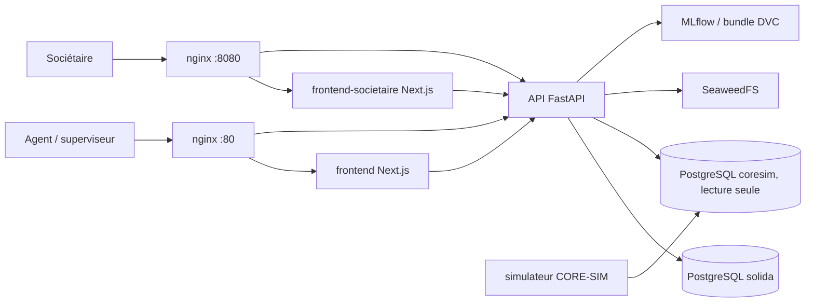

# SOLIDA

Aide à la décision d'octroi de microcrédit pour coopératives financières : un score de risque explicable, calculé à partir de la trajectoire d'épargne et du comportement de remboursement, avec un modèle enrichi pour les crédits à caution solidaire.

Projet conçu pour le Hackathon National d'Innovation CIF / DigiCoop-WA+ (thématique 02, Lomé, 11-13 septembre 2026). Il fonctionne sur des données synthétiques.

## Problème traité

Un agent de coopérative décide d'un crédit avec peu d'éléments formalisés. SOLIDA remplace cette décision isolée par une recommandation qui reste sous contrôle humain : une probabilité de défaut à 30 jours, les facteurs qui l'expliquent, une décision selon une grille paramétrable, et un journal des décisions qui ne peut qu'être complété. Pour un crédit dont l'emprunteur est un groupe (caution solidaire), le système bascule vers un second modèle qui utilise des variables de groupe, uniquement si le groupe est jugeable.

## Fonctionnalités

- Scoring en deux temps : `preview` (calcul sans écriture) puis `confirm` (décision enregistrée).
- Deux modèles de type EBM (Explainable Boosting Machine, bibliothèque `interpret`) : un socle individuel et un modèle enrichi pour les groupes. Le choix est fait par une règle de cascade du domaine (appartenance à un groupe, taille minimale de 5 membres, nombre de crédits antérieurs soldés, fraîcheur des variables), avec un motif de bascule enregistré.
- Fiche de justification par décision, exportable en PDF (WeasyPrint).
- Plafond de crédit progressif selon la trajectoire du sociétaire.
- Grille de décision paramétrable par le rôle autorisé.
- Registre des décisions, notifications (archivage, assignation à un agent), recherche et dossier d'un sociétaire.
- Authentification par session (fastapi-users), contrôle par rôle (`agent`, `superviseur`), journal d'audit en insertion seule, détection de lectures anormales.
- Portail sociétaire séparé : vérification de compte et dépôt d'une demande avec pré-vérification.
- Simulateur CORE-SIM : génère les données synthétiques d'une coopérative, lues par le backend en lecture seule.
- Chargement du modèle par alias MLflow, puis cache vérifié, puis bundle versionné avec DVC.

## Architecture



Le backend suit une Clean Architecture : `domain` (règles pures), `application` (cas d'usage), `adapters` (persistance, CORE-SIM, ML, PDF, stockage, notifications), `infrastructure` (routeurs HTTP, configuration, injection). Un contrat `import-linter` impose le sens des dépendances et interdit au domaine d'importer une bibliothèque tierce hors Pydantic.

## Stack

| Couche | Technologies |
|---|---|
| API | Python 3.12, FastAPI, Pydantic 2, SQLAlchemy 2, Alembic, psycopg 3, fastapi-users |
| Modèle | interpret (EBM), scikit-learn, pandas, DVC, MLflow |
| Frontend | Next.js 16, React 19, TypeScript, Tailwind CSS 4, Recharts, Vitest |
| Données | PostgreSQL (base applicative et base CORE-SIM), SeaweedFS |
| Infrastructure | Docker Compose, nginx |
| Qualité | pytest, ruff, mypy, import-linter, GitHub Actions (frontends), Dependabot |

## Installation

Prérequis : Docker et Docker Compose.

```bash
git clone https://github.com/Jean-Paul15/SOLIDA.git
cd SOLIDA
cp .env.example .env
```

Éditez `.env` et remplacez chaque valeur marquée comme à remplacer (mots de passe de bases, clés SeaweedFS, `SECRET_AUTH`). Le fichier `.env` n'est pas versionné.

Démarrage de la pile :

```bash
docker compose up --build
```

Le script `scripts/demarrer.sh` (ou `scripts/demarrer.ps1` sous Windows) fait la même chose en une commande : il vérifie Docker, génère un `.env` local s'il manque, construit les images et attend que l'API réponde.

## Usage

| Service | Adresse |
|---|---|
| Interface agents et superviseurs | http://localhost |
| Portail sociétaire | http://localhost:8080 |
| Santé de l'API | http://localhost/api/v1/health |

Principaux groupes de routes de l'API (préfixe `/api/v1`) : `auth`, `scoring` (`preview`, `confirm`, `{id}`, `{id}/fiche`, `{id}/fiche/pdf`, `{id}/archive`), `societaires` (`search`, `recent`, `{id}/dossier`, `{id}/groupe`), `registre`, `parametrage/grille`, `notifications`, `produits`, `portail`.

Des comptes de démonstration sont créés par une migration Alembic ; leurs identifiants sont documentés dans `docs/backend/04-authentification.md`. Ils sont réservés à un usage local.

Développement via le Makefile (les commandes passent par Docker) :

```bash
make back-install      # dépendances backend
make front-dev         # frontend en mode développement
make front-societaire-dev
```

## Tests

```bash
make back-test         # pytest
make back-lint         # ruff
make back-typecheck    # mypy
make back-imports      # contrats import-linter
make front-test        # Vitest
make front-lint front-typecheck
```

Hors Docker, depuis `backend/` : `uv sync --locked` puis `uv run pytest tests/domain` (les tests de domaine ne demandent aucune base). Les tests d'intégration exigent les bases PostgreSQL de la pile. Les modules `modelisation/` et `simulateur/` ont chacun leur dossier `tests/`.

## Structure du dépôt

```
backend/            API FastAPI, migrations Alembic, tests
frontend/           interface agents et superviseurs (Next.js)
frontend-societaire/ portail sociétaire (Next.js)
modelisation/       entraînement, évaluation et model cards des modèles EBM (pipeline DVC)
simulateur/         générateur CORE-SIM de données synthétiques
infra/              configuration nginx et scripts d'initialisation PostgreSQL
scripts/            démarrage en une commande
docs/               documentation technique (backend, frontend, infra, formules)
03-MODELE/          notes de conception du modèle et de la politique de crédit
docker-compose.yml  orchestration de la pile
dvc.yaml            pipeline de données et de modèle
```

## Limites connues

- Les données sont synthétiques ; aucune performance sur données réelles n'est établie.
- Les modèles servent d'aide à la décision : la décision finale reste humaine.
- Les comptes de démonstration et leur mot de passe commun sont destinés au développement local uniquement ; ils ne doivent pas être déployés tels quels.
- L'intégration continue ne couvre que les frontends ; le backend est vérifié via les cibles `make`.
- Certains seuils métier (grille, cascade) sont des valeurs de départ à valider avec la coopérative, voir `docs/backend/03-decisions-provisoires-a-revoir.md`.
- Des documents de `docs/backend/` évoquent encore un modèle de substitution `ModeleConstant` absent du code actuel, qui charge les modèles EBM.

## Licence

Apache License 2.0, voir le fichier `LICENSE`.

## Contact

Jean-Paul ADOGLI, GitHub : [Jean-Paul15](https://github.com/Jean-Paul15)
